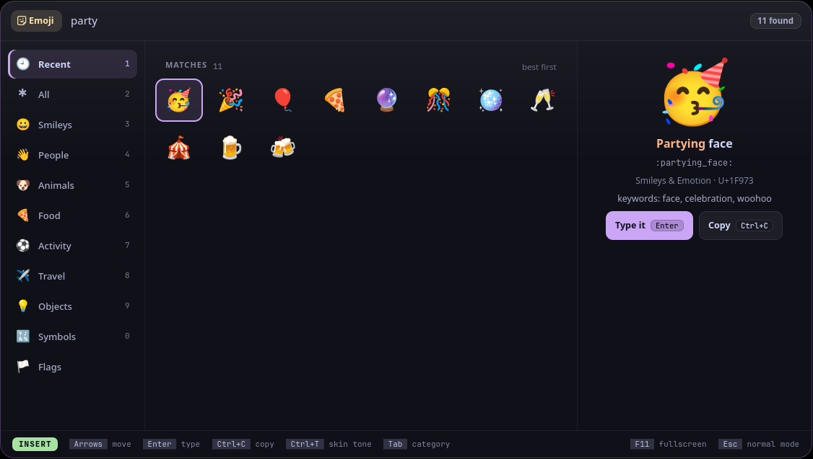
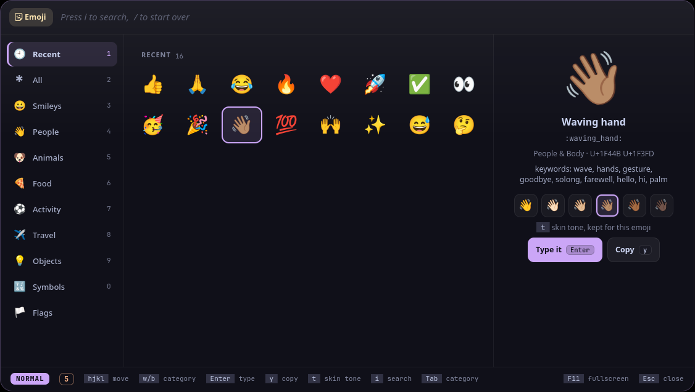

<p align="center">
  <picture>
    <source media="(prefers-color-scheme: dark)" srcset="assets/banner-dark.svg">
    <source media="(prefers-color-scheme: light)" srcset="assets/banner-light.svg">
    
  </picture>
</p>

<!-- identity -->
<p align="center">
  <b>न देवो विद्यते काष्ठे न पाषाणे न मृण्मये ।<br>
  भावे हि विद्यते देवस्तस्माद्भावो हि कारणम् ॥</b><br>
  <i>The divine is not in wood, stone or clay; it lives in feeling, so feeling is what matters.</i><br>
  <sub>Cāṇakya Nīti 8.11 (8.12 in some editions; attribution traditional)</sub>
</p>
<!-- /identity -->

<p align="center">
  <b>Emoji picker: a grid with recents first, a category rail, skin tones per emoji, a big preview and vim keys; types the emoji into the window you were in.</b><br>
  The emoji picker. A tool for <a href="https://github.com/Theyashsawarkar/vyom">Vyom</a>, keyboard-driven panels for Wayland.
</p>

<p align="center">
  <a href="https://github.com/Theyashsawarkar/bhava/actions/workflows/ci.yml"></a>
  <a href="https://github.com/Theyashsawarkar/bhava/releases"></a>
  <a href="LICENSE"></a>
  <a href="https://github.com/Theyashsawarkar/vyom"></a>
  
  
</p>

<p align="center">
  
</p>

> *Bhava* (भाव) is Sanskrit for "feeling, emotion": what an emoji is for: the feeling behind the words.

bhava is the emoji picker for [Vyom](https://github.com/Theyashsawarkar/vyom): one keyboard-driven panel that opens instantly, with live data, a preview and a key for everything. It runs on any compositor with the layer-shell protocol (sway, Hyprland, river, niri, Wayfire, labwc…). In [Vayu](https://github.com/Theyashsawarkar/vayu), the desktop it was built for, it replaces wofi-emoji.

## Contents

- [Features](#features)
- [Install](#install)
- [Usage](#usage)
- [Troubleshooting](#troubleshooting)
- [The Vyom family](#the-vyom-family)
- [Contributing](#contributing)
- [License](#license)

## Features

- Every Unicode 16 emoji in a calm **grid** of big emoji, your recent ones first; where you are is framed in the accent colour.
- A **category rail** on the left, with names: `Tab` / `Shift+Tab` or `Ctrl` with the number on it.
- **Skin tones per emoji**: a visible picker in the preview (`Ctrl+T`, or `t` in normal mode), remembered for that emoji.
- A big preview with the name, the `:shortcode:`, the code points and the keywords, **the ones your search matched in peach**.
- `Enter` **types the emoji into the window you were in** (and copies it); `Ctrl+C` (or `Ctrl+Enter`) only copies.
- **Vim modes**: type to search in INSERT, `Esc` for NORMAL, then `h` `j` `k` `l`, counts, `gg` / `G` and `y` (see [Vim modes](#vim-modes)).
- Names and groups from Unicode's emoji-test.txt, keywords from wofi-emoji (MIT): see NOTICE and tools/build-data.py.
- Keyboard first: every action has a key, shown in the footer for the mode you're in; the mouse works too.

<p align="center">
  
</p>

## Install

### Requirements

- [Vyom](https://github.com/Theyashsawarkar/vyom) 0.6 or newer (Python 3.11+, PyGObject, GTK 4, [gtk4-layer-shell](https://github.com/wmww/gtk4-layer-shell), a Nerd Font)
- optional: wtype (typing the emoji)

### Install

```sh
git clone https://github.com/Theyashsawarkar/bhava ~/.local/share/vyom/plugins/bhava
vyom reload           # pick it up (or log out and in)
vyom bhava            # open it; run it again to close
```

Give it a key in your compositor, e.g. sway:

```sh
bindsym $mod+<key> exec vyom bhava
```

### Update and uninstall

```sh
git -C ~/.local/share/vyom/plugins/bhava pull && vyom reload     # update
rm -rf ~/.local/share/vyom/plugins/bhava && vyom reload          # uninstall
```

## Usage

Open it with `vyom bhava` (or your key). Type to search; the footer always shows the keys for the mode you're in.

| Key | Action |
|---|---|
| `Arrows` | Move around the emoji grid |
| `Enter` | Type the emoji into the window you were in (and copy it) |
| `Ctrl+C` | Copy the emoji only |
| `Ctrl+Enter` | Copy the emoji only |
| `Ctrl+T` | Change the skin tone of this emoji (remembered for it) |
| `Tab / Shift+Tab` | Next / previous category |
| `Ctrl+1..9` | That numbered category (`Ctrl+0`: the tenth) |
| `Esc` | INSERT: go to NORMAL mode. NORMAL: close the panel |

In NORMAL mode:

| Key | Action |
|---|---|
| `h / j / k / l` | Move left / down / up / right in the grid |
| `1..9` | A count for the next move: `5j` five rows down, `3l` three to the right |
| `w / b` | Next / previous category |
| `gg / G` | First / last emoji (`5gg` or `5G`: row 5) |
| `0 / $` | Start / end of the row |
| `Ctrl+D / Ctrl+U` | Half a page down / up |
| `Enter` | Type the emoji (and copy it) |
| `y` | Copy the emoji only (yank) |
| `t / s` | Change the skin tone of this emoji |
| `i / a` | Back to INSERT, to type in the search |
| `/` | A new search: clears it and goes to INSERT |
| `q` | Close the panel |
| `Esc` | Close the panel (or cancel a half-typed count or `g`) |

Every Vyom panel also has `Up`/`Down` (or `Ctrl+K`/`Ctrl+J`) to move, `Page Up`/`Page Down` to jump and `F11` for fullscreen.

### Vim modes

bhava has two modes, shown in a pill at the left of the footer:

- **INSERT** (green): what you type goes into the search box. It opens in INSERT, so you can type straight away.
- **NORMAL** (the accent colour): `Esc` from INSERT. Letters don't type; they move: `h` `j` `k` `l`, `w` / `b` between categories, `gg` / `G`, `0` / `$`, `Ctrl+D` / `Ctrl+U`, with a count first (`5j`). A half-typed count or `g` shows next to the pill. The search box goes quiet (no caret, dimmed, "Press i to search").

So `Esc` twice closes the panel. To open in NORMAL instead, set in `~/.config/vyom/config.toml`:

```toml
[plugin.bhava]
start_mode = "normal"     # "insert" (the default) or "normal"
```

## Troubleshooting

- **Nothing opens.** `vyom list` shows every installed tool, and why one is skipped (a missing requirement, or a Vyom that's too old).
- **It opened, then something failed.** Look for a `Traceback` in the daemon's log, `journalctl --user -u vyom -u vyom-daemon -b` (without systemd: `~/.local/state/vyom/daemon.log`), and [open an issue](https://github.com/Theyashsawarkar/bhava/issues/new/choose) with it.
- **No blur or rounded corners.** That's the compositor: on SwayFX, add `layer_effects "vyom" { blur enable; corner_radius 20; shadows enable }`.

## The Vyom family

Each tool is its own repository, so you install only the ones you want:

| Tool | | What it does |
|---|---|---|
| [dvara](https://github.com/Theyashsawarkar/dvara) | द्वार, gateway | The app launcher |
| [ganit](https://github.com/Theyashsawarkar/ganit) | गणित, mathematics | The calculator and converter |
| [smriti](https://github.com/Theyashsawarkar/smriti) | स्मृति, memory | Clipboard history |
| [bhava](https://github.com/Theyashsawarkar/bhava) (this one) | भाव, feeling, emotion | The emoji picker |
| [tarang](https://github.com/Theyashsawarkar/tarang) | तरंग, wave | Wi‑Fi and the hotspot |
| [setu](https://github.com/Theyashsawarkar/setu) | सेतु, bridge | Bluetooth |
| [doot](https://github.com/Theyashsawarkar/doot) | दूत, messenger | Your phone, through KDE Connect |
| [patra](https://github.com/Theyashsawarkar/patra) | पात्र, vessel | Docker containers |
| [akashvani](https://github.com/Theyashsawarkar/akashvani) | आकाशवाणी, voice from the sky | Notifications |
| [raga](https://github.com/Theyashsawarkar/raga) | राग, melody | YouTube music and video |
| [mudra](https://github.com/Theyashsawarkar/mudra) | मुद्रा, gesture | Keybinding search |
| [urja](https://github.com/Theyashsawarkar/urja) | ऊर्जा, energy | The battery at a glance |
| [vishram](https://github.com/Theyashsawarkar/vishram) | विश्राम, rest | The power menu |
| [kendra](https://github.com/Theyashsawarkar/kendra) | केन्द्र, centre | Quick settings |

## Contributing

Bug reports, ideas and pull requests are welcome: see [CONTRIBUTING.md](CONTRIBUTING.md) for the development setup and the few rules every tool follows, and [CHANGELOG.md](CHANGELOG.md) for what changed in each release. Please report security issues privately ([SECURITY.md](SECURITY.md)).

## License

[MIT](LICENSE). The emoji data comes from Unicode and wofi-emoji: see [NOTICE](NOTICE).
